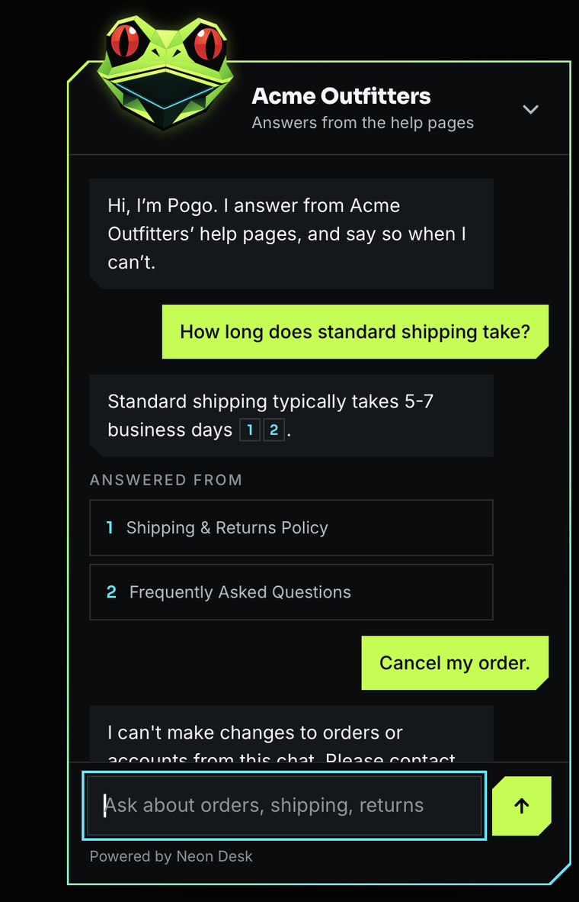
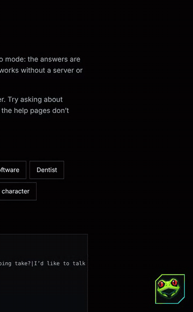
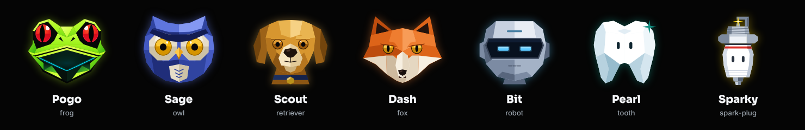

# Neon Desk

A retrieval-grounded customer support assistant any company can embed. It answers from the company's own documents, shows which ones it used, and hands off to a person when it should not answer.

**[Try the widget](https://ktodoran.github.io/neon-desk/)** in demo mode: scripted answers from the example help pages, no server and no model behind it.

> **Status: under construction.** The knowledge base, retrieval, chat API, guardrails, evaluation harness and embeddable widget are built and tested. The evaluation has been run against a small model on a laptop, and not yet against a hosted one. See [Roadmap](#roadmap) and [Known limits](#known-limits).

## What works today

- **Ingestion.** Markdown documents are split into overlapping chunks, embedded, and stored in Postgres with pgvector. Re-ingesting an unchanged document costs no embedding calls; re-ingesting an edited one replaces it in place.
- **Hybrid search.** Vector similarity and full-text search run side by side and are merged with reciprocal rank fusion, so both "what's your refund window" and "SKU-88412" find the right passage.
- **A streaming chat endpoint.** Answers arrive as server-sent events, cite the sources they used, and end with a flag saying whether the customer should be routed to a person.
- **Multi-turn conversations.** Follow-up questions are rewritten into standalone search queries using the conversation so far.
- **Routing by intent, not keywords.** "What is your refund policy?" is answered; "Refund order 1182" is handed to a person. Both mention refunds; only one asks the assistant to act.
- **A no-answer path that never asks a model to answer.** If retrieval finds nothing relevant, the reply is a fixed handoff message.
- **Card numbers removed on arrival.** A pasted card number is redacted before the model, the database or the logs see it.
- **API protection.** An origin allowlist, per-client rate limiting on the chat route, and a request size limit.
- **An evaluation harness** with 38 cases covering answerable questions, questions the knowledge base cannot answer, requests to act, follow-ups and injection attempts.
- **An embeddable widget.** One script tag and a `<neon-desk>` element put the assistant on any site, restyled by attributes. See [The widget](#the-widget).
- **Anthropic and OpenAI-compatible models** behind one small interface, including a model running on your own machine with no API key.
- **Tests that run against a real Postgres**, in process, with no Docker.

## Quick start

Requires Node.js 22.12 or newer and Docker.

```bash
cp .env.example .env
docker compose up -d
npm install
npm run migrate
npm run ingest -- examples/knowledge
npm run dev
```

```bash
curl http://localhost:3000/health
```

That much runs with no API keys. `.env.example` uses the built-in `hash` embedder, which matches on shared words only and exists for local development and tests.

To chat, set a model in `.env`:

```bash
LLM_PROVIDER=anthropic        # or "openai"
LLM_API_KEY=...
LLM_MODEL=...                 # no default: name the model you intend to use
```

```bash
curl -N -X POST http://localhost:3000/v1/chat \
  -H 'content-type: application/json' \
  -d '{"message": "What is your return policy?"}'
```

For real retrieval quality, also set `EMBEDDINGS_PROVIDER=openai` with an API key and re-ingest. Any service that implements the OpenAI embeddings endpoint works through `EMBEDDINGS_BASE_URL`.

### Without an API key: a local model

Both halves can run on your own machine through [Ollama](https://ollama.com), which serves the OpenAI API on `localhost`. Pull a chat model and an embedding model:

```bash
ollama pull gemma4:12b
ollama pull qwen3-embedding:0.6b
```

Then in `.env`:

```bash
LLM_PROVIDER=openai
LLM_BASE_URL=http://localhost:11434/v1
LLM_API_KEY=ollama                 # a local server does not check it
LLM_MODEL=gemma4:12b
LLM_REASONING_EFFORT=none          # this model thinks before it answers unless told not to

EMBEDDINGS_PROVIDER=openai
EMBEDDINGS_BASE_URL=http://localhost:11434/v1
EMBEDDINGS_API_KEY=ollama
EMBEDDINGS_MODEL=qwen3-embedding:0.6b
EMBEDDINGS_DIMENSIONS=1024         # the model's own width, padded to the stored 1536
```

The [evaluation](#evaluation) below was run with exactly these settings, on Ollama 0.40.18. A conversation through the HTTP server and the widget was also checked by hand with them: an answer with its sources, a request to act, and a question the help pages do not cover. Re-ingest after changing the embedding model: documents are re-embedded when the model's name changes.



## API

### `POST /v1/chat`

```json
{ "message": "and for international orders?", "conversationId": "optional uuid" }
```

Omit `conversationId` to start a conversation; send the one you received to continue it.

The response is a stream of server-sent events:

| Event   | Data                               | When                                   |
| ------- | ---------------------------------- | -------------------------------------- |
| `meta`  | `{ conversationId }`               | Once, first                            |
| `delta` | `{ text }`                         | As the answer is generated             |
| `done`  | `{ citations, escalated, reason }` | Once, on success                       |
| `error` | `{ code, message }`                | Instead of `done`, if the stream fails |

`citations` lists each source the answer cited: `{ marker, title, url, documentId }`.

`escalated` is `true` when the customer should be routed to a person, and `reason` says why:

| `reason`              | Meaning                                                   |
| --------------------- | --------------------------------------------------------- |
| `action_request`      | The customer asked for a change to an order or account    |
| `human_request`       | The customer asked for a person, or is making a complaint |
| `no_relevant_sources` | Retrieval found nothing to answer from                    |
| `ungrounded_answer`   | The model answered without citing a source                |

`reason` is `null` when `escalated` is `false`.

Problems found before the stream starts come back as ordinary JSON errors: `400` for an invalid body, `404` for an unknown conversation, `413` for an oversized body, `429` when rate limited, `503` when no model is configured.

### `GET /health`

`200 {"status":"ok"}` when the database answers, `503` when it does not.

## Putting it on a website

The API is meant to be called from a widget in a customer's browser, which cannot keep a secret. Access is controlled by which sites the browser will let call it, and cost by rate limiting.

```bash
ALLOWED_ORIGINS=https://www.example.com,https://shop.example.com
RATE_LIMIT_MAX=20
RATE_LIMIT_WINDOW_SECONDS=60
TRUST_PROXY=true    # only behind a proxy you control
```

With `ALLOWED_ORIGINS` empty, no cross-origin browser request is allowed.

## The widget



The server hosts the widget at `/widget.js`, so a site needs one address for the script and the API:

```html
<script src="https://support.example.com/widget.js" defer></script>
<neon-desk endpoint="https://support.example.com" name="Acme Outfitters"></neon-desk>
```

Add the site's origin to `ALLOWED_ORIGINS` and that is the whole installation.

### Try it without a server

The [demo page](https://ktodoran.github.io/neon-desk/) is published from this repository on every change to the widget. To run it locally:

```bash
npm run demo    # http://127.0.0.1:8000
```

The demo page runs the widget with the `demo` attribute, which swaps the server for a few scripted answers taken from `examples/knowledge`. It follows the same rules as the real assistant: answer and cite, refuse to act, hand off when asked or when nothing matches. The footer says "demo mode" whenever it is on.

To put a real server behind the same page, start one with `ALLOWED_ORIGINS=http://127.0.0.1:8000` and open `http://127.0.0.1:8000/?server=http://localhost:3000`. The page accepts only a server on the same machine.

### Settings

Everything is an attribute, and changing one restyles the widget in place without losing the conversation.

| Attribute                          | What it does                                                                                                                               |
| ---------------------------------- | ------------------------------------------------------------------------------------------------------------------------------------------ |
| `endpoint`                         | Where your Neon Desk server lives.                                                                                                         |
| `name`                             | The company name, shown in the header and the greeting.                                                                                    |
| `theme`                            | `dark` (default) or `light`.                                                                                                               |
| `accent`                           | One brand color as hex. The text on it is chosen, black or white, for contrast.                                                            |
| `corners`                          | `cut` (default), `round` or `square`.                                                                                                      |
| `font`                             | A font family already loaded on the page. The widget loads no fonts of its own.                                                            |
| `mascot`                           | A built-in character (`frog` by default), one you registered, the URL of your own image, or `none`. See [The characters](#the-characters). |
| `mascot-name`                      | What the character is called, in place of its own name.                                                                                    |
| `position`                         | `bottom-right` (default) or `bottom-left`.                                                                                                 |
| `greeting`, `placeholder`, `nudge` | Copy for the first message, the text box, and a bubble beside the closed launcher.                                                         |
| `suggestions`                      | Starter questions, separated by `\|`.                                                                                                      |
| `handoff-url`                      | Where "Contact the team" goes when a person is needed: a web, `mailto:` or `tel:` link.                                                    |
| `demo`                             | Scripted answers, no server.                                                                                                               |

It also fires `neon-desk:open`, `neon-desk:close` and `neon-desk:handoff` (with the reason) on the element, so a site can open its own live chat when the assistant hands off.

### The characters



Seven characters ship with the widget. Each keeps its own colors whatever the `accent` is, sits on a plate in those colors in the launcher, and has one signal light that comes on while the assistant is working.

| `mascot`     | Name   | Signal light          | Speaks with    |
| ------------ | ------ | --------------------- | -------------- |
| `frog`       | Pogo   | Throat                | Lower jaw      |
| `owl`        | Sage   | Chest feathers        | Lower beak     |
| `retriever`  | Scout  | Collar tag            | Lower jaw      |
| `fox`        | Dash   | Ears                  | Lower jaw      |
| `robot`      | Bit    | Strip on its forehead | The same strip |
| `tooth`      | Pearl  | Glint                 | The same glint |
| `spark-plug` | Sparky | Spark                 | The same spark |

The name appears in the greeting, in the header while it works ("Sage is reading") and in the launcher's label for screen readers. `mascot-name` changes it.

A character is not decoration: each thing it does reports something the API is doing.

| It does this                                                           | When                                                         |
| ---------------------------------------------------------------------- | ------------------------------------------------------------ |
| Eyes and head follow the pointer; it looks down the page as you scroll | Always. With nothing to watch, it glances around on its own. |
| Eyes follow the text as it is typed; the body stays still              | The customer is typing.                                      |
| Eyes sweep left to right, signal light pulses                          | The question is sent and nothing has come back yet.          |
| Jaw moves, or the signal light flickers, once per piece of text        | The answer is streaming, one `delta` at a time.              |
| Hops                                                                   | `done` arrived and the answer stands.                        |
| Looks down at the handoff card                                         | `done` arrived with `escalated: true`.                       |
| Eyes closed, colors dulled                                             | The request failed.                                          |
| Leaps between the launcher and the panel                               | The chat opens or closes.                                    |

Tap it and it hops. With `prefers-reduced-motion` set, none of this moves: the character sits still and only its signal light shows that an answer is on the way.

### A character of your own

The motion is not tied to the drawings. One rig moves every character, and a drawing opts in by naming its parts, so a company can bring its own:

```html
<script src="https://support.example.com/widget.js"></script>
<script>
  customElements.get('neon-desk').registerCharacter({
    id: 'leaf', // then: <neon-desk mascot="leaf">
    name: 'Fern',
    svg: '<svg viewBox="0 0 560 470">…</svg>',
    look: { x: 12, y: 9 }, // how far the pupils travel, in the drawing's units
    glow: '#3fb06a',
    plate: { ground: '#0f2418', edge: ['#49bf75', '#ffd60a'] }, // its launcher
  });
</script>
```

| Class on a part | What the rig does with it                                   |
| --------------- | ----------------------------------------------------------- |
| `ndc-pupil`     | Slides it toward whatever the character is looking at.      |
| `ndc-lid`       | Scales it down from the top to cover an eye.                |
| `ndc-crease`    | Shows it only while the eyes are shut.                      |
| `ndc-jaw`       | Drops it while the character speaks, by the `jaw` distance. |
| `ndc-on`        | The signal light: dim at rest, bright while working.        |
| `ndc-sig`       | Invisible at rest; appears with the signal.                 |
| `ndc-soft`      | A faint halo around the signal light.                       |
| `ndc-grow`      | Swells with the signal.                                     |

A drawing without `jaw` speaks with its signal light. Every part is optional: a drawing that names none still leaps and hops.

A registered drawing is cleaned before it is used. Only shapes, gradients, clip paths and masks are kept; scripts, embedded documents, event handlers and anything that loads from outside the drawing are removed. A definition the widget cannot use throws a `TypeError` that says why. The [demo page](examples/widget/index.html) registers one this way.

A company's existing logo works too: `mascot="https://example.com/logo.svg"` leaps and hops, but an image cannot blink or look around. With `mascot="none"` the launcher is a chat icon on the accent color.

[Neon Toad Digital](https://neontoaddigital.com) draws characters for this rig to order.

### How it is built

- **A custom element with a shadow root.** The host page's CSS cannot reach in, and the widget's cannot leak out. Checked on a page with hostile global styles (`button { border-radius: 99px !important }`), which left it untouched.
- **No framework and no runtime dependencies.** About 20 kB gzipped, roughly 8 of it the seven drawings.
- **One rig, and characters are data.** Each frame the rig writes five numbers (where it is looking, how shut its eyes are, jaw, signal) as CSS custom properties, and the drawing's own part names decide what they move. Adding a character adds no logic.
- **Everything from outside is text.** Answers, source titles and attributes are inserted as text nodes, never as markup, and only `http`, `https`, `mailto` and `tel` addresses become links. A font or color that is not a plain font list or hex color is ignored.
- **The conversation is one value changed by one function.** What is on screen is drawn from it, and only a message that changed is redrawn, so a streamed answer does not replay animations or make a screen reader start over.
- **It shares the server's SSE decoder**, and its transport is tested against the real server over a real socket.
- **Keyboard and screen reader.** The launcher and panel are labelled, focus moves into the chat on open and back to the launcher on close, Escape closes, and the message list is a live region that waits for a complete answer.

## Evaluation

```bash
npm run eval                      # full pipeline, using the model in .env
npm run eval -- --retrieval-only  # search only, no model calls
npm run eval -- --write           # also save the report to evals/RESULTS.md
```

The harness loads the sample knowledge base into an in-process Postgres, runs every case in `evals/dataset.ts` through the real pipeline, and reports:

- **Retrieval:** recall at 1, 3 and 5, and mean reciprocal rank, for questions with a known source document.
- **Routing accuracy:** whether the assistant answered or handed off as it should have.
- **Citation accuracy:** whether an answer cited a document that actually holds the answer.
- **Pass rate by category,** including four injection attempts, one of which is a document planted in the knowledge base that contains instructions aimed at the assistant.

Every check is mechanical: which document was cited, whether a required fact appears, whether a forbidden string leaked. There is no model grading another model, so a run costs only the calls being evaluated.

### Results

Run on a laptop, with no hosted model: `gemma4:12b` for chat with thinking off, `qwen3-embedding:0.6b` for embeddings, both through Ollama. The full report is in [evals/RESULTS.md](evals/RESULTS.md).

| Measure                                | Result      |
| -------------------------------------- | ----------- |
| Cases passed                           | 38 of 38    |
| Routing accuracy                       | 100%        |
| Citation accuracy                      | 100%        |
| Retrieval: right document ranked first | 90.9% of 22 |
| Retrieval: right document in the top 3 | 100% of 22  |

Read these for what they are:

- **The set is small and written by the same person as the system.** 38 cases over 4 documents. Passing all of them shows the pipeline does what it was built to do on the cases its author thought of. It says little about how it would do on a real company's documents and customers.
- **It is one model, run twice.** Both runs passed every case, and the second is the saved report. Model output still varies between runs, and a different model will behave differently. It has not been run against a hosted model.
- **The first runs did not pass.** Two earlier runs passed 35 of 38, with the same three failures each time. The model had answered correctly but cited two sources in one pair of brackets, as in `[1, 2]`, which the citation reader did not recognize, so the answers were treated as ungrounded and handed off. The reader now accepts that form, and the report now says why a case was handed off and what the assistant said.

## Checks

```bash
npm run typecheck
npm run lint
npm test
npm run format:check
npm run build
```

## Design decisions

**Documents are identified by where they came from, not by their content.** A document's key is `(source, external_id)`. Keying on a content hash, the obvious shortcut, means every edit creates a second copy and the stale one keeps getting retrieved. The hash is still stored, but only to skip re-embedding when nothing changed.

**Embedding happens before the transaction opens.** A network call to an embeddings provider can take seconds or fail. Doing it first means no database transaction is held open across it, and a provider failure leaves the previous version of the document untouched.

**Two retrievers, fused by rank.** Embeddings capture meaning but are weak on exact tokens such as product codes. Full-text search is the reverse. Their scores are on unrelated scales, so they are combined by rank position (reciprocal rank fusion) rather than by adding scores.

**Guardrails decide on intent, not vocabulary.** A keyword filter that blocks "refund" refuses the most common support question there is. One small model call classifies what the customer is asking the assistant to do and, in the same call, produces the search query. Requests to act and requests for a person get a fixed reply and are never searched or answered.

**Routing fails open, into a grounded path.** If the routing call fails or returns something unparseable, the message is treated as a question. The answering step is still limited to retrieved sources, is told it cannot perform actions, and escalates when it cites nothing. Failing the other way would turn a model hiccup into a refused customer.

**No answer is requested when there is nothing to ground it in.** A chunk is kept only if it matched keywords or cleared a similarity threshold. If none did, the customer gets a fixed handoff message. The cheapest and most reliable way to stop a model from inventing an answer is not to ask it.

**Retrieved text cannot close its own fence.** Sources are wrapped in tags and the model is told to treat them as data. Any tag-like text inside a document is neutralized first, so a document cannot end its block early and have the rest read as instructions.

**Card numbers are removed with a checksum, not just a pattern.** Candidates must pass the Luhn check, which is what keeps order numbers and tracking codes from being redacted by accident.

**The origin allowlist is not the cost control; the rate limit is.** An `Origin` header is trivially forged outside a browser. The allowlist stops other websites from embedding the assistant. The per-client limit on the chat route is what bounds spend.

**Follow-ups are rewritten before retrieval.** "And for international?" retrieves nothing useful on its own. The routing call rewrites each message into a standalone query using the conversation so far. The answering call still sees the customer's own words.

**Only complete exchanges are stored.** The question and answer are written together, in one transaction, after the answer finishes. If the model fails halfway, the conversation is left exactly as it was.

**Request problems fail before the stream starts.** Validation, the conversation lookup and retrieval all happen before the first byte is sent, so they can return a normal status code. Only a failure during generation has to be reported in-band.

**Generation stops when the client disconnects.** A closed tab aborts the upstream model request, so abandoned answers are not paid for.

**Model and embeddings clients are plain `fetch`.** Each provider contract here is one HTTP endpoint and one stream format, under two hundred lines in total including the SSE parser. Not depending on vendor SDKs keeps providers swappable by URL. The cost is that retries and backoff are not built in yet.

**Provider errors show the provider's code, never its body.** A failed call reports the HTTP status and the short machine-readable code, such as `insufficient_quota`. That names the cause without echoing a response body that could contain request data.

**Changing the embedding model re-embeds.** Vectors from different models are not comparable. Each document records the model that embedded it, so a re-ingest after a model change replaces the vectors instead of skipping the document as unchanged.

**Search order is deterministic.** Fused scores tie often, because they depend only on rank. Ties are broken on properties of the content, never on generated ids, so the same data and query always return the same order.

**No default model.** A hardcoded model name goes stale and then fails in production. The operator names the model.

**Tests run against Postgres, not a mock of it.** The suite uses [PGlite](https://pglite.dev), Postgres compiled to WebAssembly, with the pgvector extension loaded. One test file also drives the production `node-postgres` adapter over a real socket. The SSE parser is tested with a stream split at every byte position, and the model clients against streams in each provider's documented shape.

**Environment booleans are parsed explicitly.** `z.coerce.boolean()` turns the string `"false"` into `true`. Only `true`, `false`, `1` and `0` are accepted.

**The embedding width is fixed at 1536.** It is part of the column type. A model with narrower vectors still fits: set `EMBEDDINGS_DIMENSIONS` to its width and its vectors are padded with zeros, which changes neither their lengths nor the angles between them, so every similarity score is the same as before. A wider model has to be asked for 1536, or needs a migration and a re-ingest.

## Known limits

- **Quality has been measured on one small set.** 38 cases against one small local model, described under [Results](#results). There are no numbers for a hosted model or for a real company's documents.
- **Citations are detected, not verified.** The server checks which source numbers the answer referenced. The evaluation checks that the cited document holds the answer and that required facts appear, but nothing verifies each claim sentence by sentence.
- **Prompt-injection defenses are mitigations.** Fencing, neutralized tags and routing reduce the attack surface. The injection cases in the evaluation measure how well that holds for a given model; they do not prove it.
- **Rate-limit counters live in one process.** Behind several instances the effective limit is multiplied until a shared store is added.
- **There is no per-user authentication.** The API identifies callers by network address only.
- **Model calls are not retried.**
- **Only card numbers are redacted.** Other personal data in a message is stored as written.
- **The widget forgets on reload.** The server keeps the conversation, but the widget does not restore it after the page is refreshed.
- **The widget is English only**, and renders answers as plain text: Markdown in an answer is shown as written.
- **The widget's motion was checked by hand, in Chrome and Safari.** The logic is unit tested, but there is no automated browser test, and Firefox has not been checked.

## Layout

```
migrations/        SQL migrations, applied in filename order
src/config.ts      Environment parsing and validation
src/db/            Database interface, Postgres adapter, migration runner
src/rag/           Chunking, embeddings, ingestion, vector and hybrid search
src/llm/           Model interface, SSE parser, Anthropic and OpenAI clients
src/chat/          Routing, redaction, prompts, conversation store, chat pipeline
src/cli/           migrate and ingest commands
src/server.ts      HTTP server
widget/            The <neon-desk> element: characters, the rig that moves them, conversation state, transport, styles
evals/             Evaluation cases, harness and report
test/              Unit and integration tests
examples/knowledge Sample documents
examples/widget    Demo page for the widget
```

## Roadmap

1. **Foundation** — done.
2. **Retrieval and chat** — done.
3. **Guardrails and evaluation** — done for a local model. Remaining: a run against a hosted model.
4. **Embeddable widget** — done.
5. **Deployment** — a Shopify example and an AWS deployment guide.

## License

[MIT](LICENSE)
